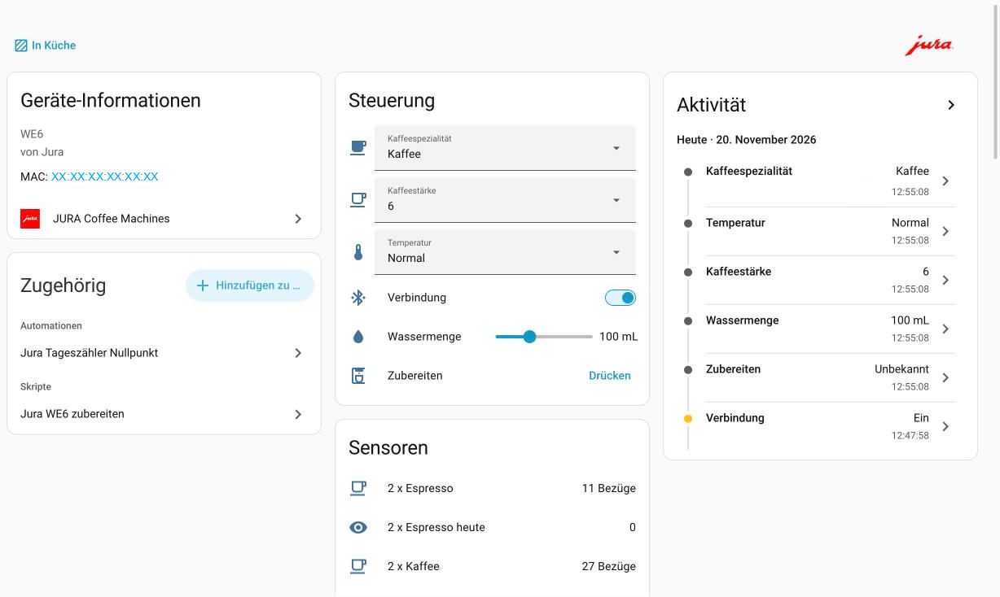
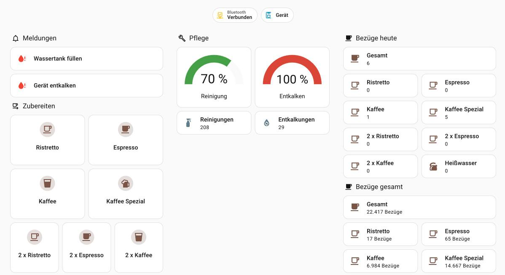

# JURA-Kaffeevollautomaten für Home Assistant

[English](README.md) | **Deutsch**

Custom-Integration für [Home Assistant](https://www.home-assistant.io/), die JURA-Kaffeevollautomaten über das Bluetooth-Modul [JURA Smart Connect](https://us.jura.com/en/homeproducts/accessories/SmartConnect-Main-72167) einbindet. Ein Fork von [AlexxIT/Jura](https://github.com/AlexxIT/Jura), zusammengeführt mit Verbesserungen aus anderen Forks und erweitert, siehe [Fork und Dank](#fork-und-dank).

## Was die Integration kann

- **Statistik:** Bezüge gesamt und ein Zähler je Produkt, benannt wie in der JURA-App.
- **Tageszähler:** Bezüge heute, in Home Assistant berechnet, mit fertigem Dashboard.
- **Pflege:** Reinigen, Entkalken, Filter: Zähler und Stand in Prozent, soweit die Maschine sie hat. Was die Maschine nicht benutzt (z. B. den Filter ohne Patrone), wird ausgeblendet.
- **Meldungen und Vorwarnungen:** Wassertank füllen, Schale leeren, Bohnen füllen, reinigen, entkalken, Filter wechseln, „bald“-Vorwarnungen, genau so, wie die Maschinendatei sie für das Modell festlegt.
- **Zubereiten:** Produkt, Stärke, Temperatur und Mengen, mit Taste *Zubereiten*.
- **Nur auslesen:** auf Wunsch ganz ohne Steuerung, etwa für Sprachassistenten oder Dashboards für alle.
- **Deutsch und Englisch**, in der Sprache von Home Assistant.
- Läuft auch bei ausgeschalteter Maschine: Die letzten Werte bleiben stehen, und die Integration verbindet sich wieder, sobald die Maschine an ist.

## Voraussetzungen

- Eine JURA-Maschine mit **Smart-Connect-Modul** (Bluetooth). Das WLAN-Modul wird nicht unterstützt.
- **Bluetooth in Home Assistant**, entweder
  - direkt über die [Bluetooth-Integration](https://www.home-assistant.io/integrations/bluetooth/) mit einem unterstützten Adapter oder
  - über einen [ESPHome-Bluetooth-Proxy](https://esphome.io/components/bluetooth_proxy.html) mit aktiven Verbindungen (`active: true`).
- **Tipp:** den Empfänger nah an die Maschine bringen. Wir nutzen einen [M5Stack AtomS3U](https://docs.m5stack.com/en/core/AtomS3U) (ein ESP32-S3 als USB-Stick) als ESPHome-Bluetooth-Proxy in einer Steckdose mit USB neben der Maschine. Jeder ESP32 mit Bluetooth sollte gehen.
- Die Maschine darf nicht mit einer PIN geschützt sein.

## Dashboard

Ein fertiges Dashboard mit Tageszählern, auf Deutsch und Englisch: **[Anleitung zum Dashboard](docs/dashboard.de.md)** · [English guide](docs/dashboard.md)

## Installation

**[Installation und Einrichtung](docs/installation.de.md)** · [English guide](docs/installation.md): HACS (Marketplace), Installation von Hand, Umstieg vom Original, Option „Nur auslesen“.

Was die Integration anlegt: **[Entitäten](docs/entities.de.md)** · [English](docs/entities.md)

## Bluetooth-Fehlersuche und Analyse

- **[Bluetooth-Fehlersuche](docs/troubleshooting.de.md)** · [English](docs/troubleshooting.md): Empfänger, Reichweite, ESPHome-Proxy, die Maschine wird nicht gefunden, ein anderes Gerät kommt nicht an die Maschine.
- **[Analyse](docs/analysis.de.md)** · [English](docs/analysis.md): mit [`tools/jura_inspect.py`](tools/jura_inspect.py) die ganze Maschine von einem Mac (oder Linux-/Windows-Rechner) auslesen und herausfinden, was sie kann: Produkte, Meldungen, Wartung, Statistik, Einstellungsregister und Bluetooth-Dienste. Mit dem Protokoll, unseren Ergebnissen für die WE6 und ihr Modul „BlueFrog“, einem Schreibmodus **auf eigene Gefahr** und einer Anleitung für eigene Skripte.

## Getestete Maschinen

Dieser Fork läuft mit einer **WE6**. Laut Original außerdem: [D4](https://github.com/AlexxIT/Jura/issues/49), [E4](https://github.com/AlexxIT/Jura/issues/47), [E6](https://github.com/AlexxIT/Jura/issues/13), E8, ENA8 (mit Tasten), [S8](https://github.com/AlexxIT/Jura/issues/20), [Z8](https://github.com/AlexxIT/Jura/issues/15). Andere Modelle sollten gehen, solange ihre Maschinendatei in `resources.zip` steht.

## Grenzen

- **Über Bluetooth nicht lesbar** (WE6): Wasserhärte, Abschalt-Timer und der Tageszähler der Maschine. Den Abschalt-Timer kann man auch nicht setzen. Einzelheiten unter [Analyse](docs/analysis.de.md#ergebnisse-für-die-we6).
- **Werte nur bei Verbindung:** Die Maschine liefert Werte nur, solange sie an und verbunden ist. Bezüge, die Home Assistant nicht lesen konnte, zählen in den Gesamtzählern, aber keinem Tag.
- **Nur eine Verbindung gleichzeitig:** Solange Home Assistant verbunden ist, kommt die JURA-App nicht an die Maschine. Siehe [Fehlersuche](docs/troubleshooting.de.md#ein-anderes-gerät-kann-sich-nicht-verbinden).
- **Kein WLAN:** Das [WLAN-Modul](https://us.jura.com/en/homeproducts/accessories/WiFi-Connect-24160) wird nicht unterstützt und ist auch nicht geplant.
- **Keine PIN:** Maschinen mit PIN-Schutz werden nicht unterstützt.

## Fork und Dank

### Was dieser Fork gegenüber dem Original ändert

| Änderung | Herkunft |
|---|---|
| Sauberes Entladen, erneuter Einrichtungsversuch statt Abbruch, aktuelles Bluetooth-Gerät bei jeder Verbindung, aktive Suche (das Modell steht nur in der Scan-Antwort) | [madAndroid, AlexxIT/Jura#77](https://github.com/AlexxIT/Jura/pull/77) |
| Sensoren „Descaling Needed“ und „Descaling Soon“, Wartungszähler und Wartungsstand in Prozent, Einrichtung bei ausgeschalteter Maschine mit den letzten Werten | [Andrei Marinache, AlexxIT/Jura#41](https://github.com/AlexxIT/Jura/pull/41) |
| Sensor „No Beans“, richtiger Schlüssel im Statistikbefehl, weniger Log-Rauschen | [tidalf, AlexxIT/Jura#59](https://github.com/AlexxIT/Jura/pull/59) |
| Option **Nur auslesen, keine Steuerung**, Entitätsnamen auf Deutsch und Englisch, Produkt- und Meldungsnamen wie in der JURA-App, Milchsystem-Meldungen nur bei Maschinen mit Milchsystem | neu in diesem Fork |
| Meldungen und Vorwarnungen genau so, wie die Maschinendatei in `resources.zip` sie festlegt (z. B. „Gerät bald reinigen“, „Filter bald wechseln“, „Filter aktiv“); Wartung, die die Maschine nicht benutzt (z. B. Filter ohne Patrone), wird ausgeblendet | neu in diesem Fork |
| Fertiges Dashboard und Tageszähler („Bezüge heute“) auf Deutsch und Englisch, siehe [Dashboard](docs/dashboard.de.md) | neu in diesem Fork |
| Analyse-Werkzeug für den Rechner (`tools/jura_inspect.py`), Dokumentation des Protokolls und dessen, was die WE6 über Bluetooth preisgibt, siehe [Analyse](docs/analysis.de.md) | neu in diesem Fork |

Die Steuerung bleibt vollständig enthalten und ist Standard. Die Entitäts-IDs sind dieselben wie beim Original; wer umsteigt, behält Verlauf und Statistik.

### Dank

- **[AlexxIT](https://github.com/AlexxIT)** für die Integration, das Protokoll und die jahrelange Pflege, ohne die es diesen Fork nicht gäbe.
- **[madAndroid](https://github.com/madAndroid)** (Andrew Stangl) für die Fixes zu Einrichtung, Verbindung und aktiver Suche.
- **[Andrei Marinache](https://github.com/andrei-marinache)** für Entkalken, Wartungszähler und die Einrichtung bei ausgeschalteter Maschine.
- **[tidalf](https://github.com/tidalf)** (Cyril Leclerc) für „No Beans“ und die Korrekturen am Statistikbefehl.
- Allen, die im Original-Repo Maschinen getestet, Protokolle mitgeschnitten und Fehler gemeldet haben.

Zusammengeführt, ergänzt und getestet wurde der Fork von [textlastig](https://github.com/textlastig) mit Unterstützung von [Claude](https://claude.com/claude-code) (Anthropic). Übernommene Commits tragen ihre ursprünglichen Autoren, nachgebaute Teile nennen sie als Co-Autoren.

## Nützliche Links

- [Jutta-Proto/protocol-bt-cpp](https://github.com/Jutta-Proto/protocol-bt-cpp): Bluetooth-Protokoll
- [Jutta-Proto/protocol-cpp](https://github.com/Jutta-Proto/protocol-cpp): serielles Protokoll
- [franfrancisco9/Jura-Python-BT](https://github.com/franfrancisco9/Jura-Python-BT)
- [lunarius.fe80.eu](https://lunarius.fe80.eu/blog/tag/bluetooth.html)

## Lizenz

Der Code steht unter der [MIT-Lizenz](LICENSE), wie das Original von AlexxIT. Die Beiträge aus den Pull Requests AlexxIT/Jura#41, #59 und #77 wurden in das MIT-lizenzierte Original-Repo eingereicht und stehen damit unter derselben Lizenz. Die Rechte an den übernommenen Beiträgen liegen bei ihren Autoren.

**Ausgenommen:** `custom_components/jura/core/resources.zip` enthält die Maschinendateien von JURA (Produkte, Einstellungen und Meldungen je Modell). Sie stammen von JURA, fallen nicht unter die MIT-Lizenz und sind nur zum Betrieb dieser Integration enthalten, wie im Original. Dasselbe gilt für die Produkt-, Einstellungs- und Meldungsnamen in `translations/*.json` und `core/texts.json`, die aus der JURA-App J.O.E. übernommen sind.

JURA und Smart Connect sind Marken der JURA Elektroapparate AG. Dieses Projekt ist nicht mit JURA verbunden.
