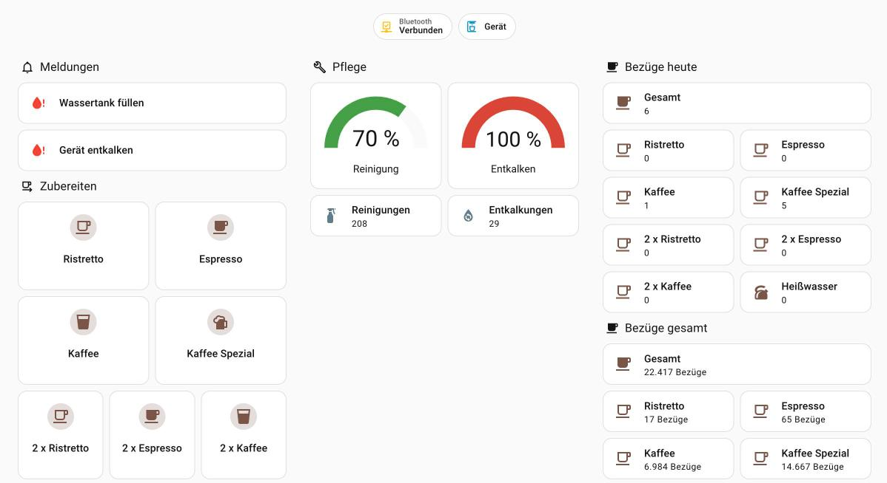

# JURA Coffee Machines for Home Assistant

**English** | [Deutsch](README.de.md)

Custom integration for [Home Assistant](https://www.home-assistant.io/) that connects JURA coffee machines through the [JURA Smart Connect](https://us.jura.com/en/homeproducts/accessories/SmartConnect-Main-72167) Bluetooth module. A fork of [AlexxIT/Jura](https://github.com/AlexxIT/Jura), merged with improvements from other forks and extended, see [Fork and thanks](#fork-and-thanks).

## What it does

- **Statistics:** total products and one counter per product, named as in the JURA app.
- **Daily counters:** products today, calculated in Home Assistant, with a ready-made dashboard.
- **Maintenance:** cleaning, descaling, filter: counters and percentages, as far as the machine has them. What the machine does not use (e.g. the filter without a cartridge) is hidden.
- **Alerts and early warnings:** fill water, empty tray, add beans, clean, descale, change filter, "soon" warnings, exactly as the machine file defines them for the model.
- **Make products:** product, strength, temperature and amounts, with a *Make* button.
- **Read only:** optionally without any control, for example for voice assistants or shared dashboards.
- **English and German**, in the language of Home Assistant.
- Works while the machine is off: the last values stay, and the integration reconnects when the machine is on.

## Requirements

- A JURA machine with a **Smart Connect** module (Bluetooth). The Wi-Fi module is not supported.
- **Bluetooth in Home Assistant**, either
  - directly through the [Bluetooth integration](https://www.home-assistant.io/integrations/bluetooth/) with a supported adapter, or
  - through an [ESPHome Bluetooth proxy](https://esphome.io/components/bluetooth_proxy.html) with active connections (`active: true`).
- **Tip:** put the receiver close to the machine. We use an [M5Stack AtomS3U](https://docs.m5stack.com/en/core/AtomS3U) (an ESP32-S3 as a USB stick) as an ESPHome Bluetooth proxy in a wall socket with USB next to the machine. Any ESP32 with Bluetooth should work.
- The machine must not be protected by a PIN.

## Dashboard

A ready-made dashboard with daily counters, in English and German: **[Dashboard guide](docs/dashboard.md)** · [Anleitung auf Deutsch](docs/dashboard.de.md)

## Installation

**[Installation and setup](docs/installation.md)** · [Anleitung auf Deutsch](docs/installation.de.md): HACS (Marketplace), manual installation, switching from the original, the option "Read only".

What the integration creates: **[Entities](docs/entities.md)** · [Deutsch](docs/entities.de.md)

## Bluetooth troubleshooting and analysis

- **[Bluetooth troubleshooting](docs/troubleshooting.md)** · [Deutsch](docs/troubleshooting.de.md): receiver, range, ESPHome proxy, the machine is not found, another device cannot connect.
- **[Analysis](docs/analysis.md)** · [Deutsch](docs/analysis.de.md): read the whole machine from a Mac (or a Linux/Windows computer) with [`tools/jura_inspect.py`](tools/jura_inspect.py) and find out what it can do: products, alerts, maintenance, statistics, setting registers and Bluetooth services. With the protocol, our results for the WE6 and its "BlueFrog" module, a write mode **at your own risk** and a guide to writing your own scripts.

## Tested machines

This fork runs with a **WE6**. According to the original also: [D4](https://github.com/AlexxIT/Jura/issues/49), [E4](https://github.com/AlexxIT/Jura/issues/47), [E6](https://github.com/AlexxIT/Jura/issues/13), E8, ENA8 (with physical buttons), [S8](https://github.com/AlexxIT/Jura/issues/20), [Z8](https://github.com/AlexxIT/Jura/issues/15). Other models should work as long as their machine file is included in `resources.zip`.

## Limitations

- **Not readable over Bluetooth** (WE6): water hardness, auto-off timer and the machine's daily counter. The auto-off timer cannot be set either. Details in [Analysis](docs/analysis.md#results-for-the-we6).
- **Values only while connected:** the machine reports values only while it is on and connected. Products made while Home Assistant could not read are counted in the totals but not assigned to a day.
- **One connection at a time:** while Home Assistant is connected, the JURA app cannot connect. See [troubleshooting](docs/troubleshooting.md#another-device-cannot-connect).
- **No Wi-Fi:** the [Wi-Fi module](https://us.jura.com/en/homeproducts/accessories/WiFi-Connect-24160) is not supported and not planned.
- **No PIN:** machines protected by a PIN are not supported.

## Fork and thanks

### What this fork changes

| Change | Source |
|---|---|
| Clean unload, setup retry instead of failure, fresh Bluetooth device on every connection, active scanning (the model is only sent in the scan response) | [madAndroid, AlexxIT/Jura#77](https://github.com/AlexxIT/Jura/pull/77) |
| "Descaling Needed" and "Descaling Soon" sensors, maintenance counters and maintenance percentages, setup while the machine is off with the last known values | [Andrei Marinache, AlexxIT/Jura#41](https://github.com/AlexxIT/Jura/pull/41) |
| "No Beans" sensor, correct key in the statistics command, less log noise | [tidalf, AlexxIT/Jura#59](https://github.com/AlexxIT/Jura/pull/59) |
| **Read only, no control** option, entity names in English and German, product and alert names as in the JURA app, milk system alerts only for machines with a milk system | new in this fork |
| Alerts and early warnings exactly as the machine file in `resources.zip` defines them (e.g. "Clean the machine soon", "Change the filter soon", "Filter active"); maintenance the machine does not use (e.g. the filter without a cartridge) is hidden | new in this fork |
| Ready-made dashboard and daily counters ("products today") in English and German, see [Dashboard](docs/dashboard.md) | new in this fork |
| Analysis tool for computers (`tools/jura_inspect.py`), documentation of the protocol and of what the WE6 reveals over Bluetooth, see [Analysis](docs/analysis.md) | new in this fork |

Control features are fully included and enabled by default. Entity IDs are the same as in the original, so switching keeps your history and statistics.

### Thanks

- **[AlexxIT](https://github.com/AlexxIT)** for the integration, the protocol work and years of maintenance; this fork would not exist without it.
- **[madAndroid](https://github.com/madAndroid)** (Andrew Stangl) for the fixes to setup, connection and active scanning.
- **[Andrei Marinache](https://github.com/andrei-marinache)** for descaling, maintenance counters and setup while the machine is off.
- **[tidalf](https://github.com/tidalf)** (Cyril Leclerc) for "No Beans" and the statistics command fixes.
- Everyone who tested machines, captured protocols and reported bugs in the original repository.

The fork was merged, extended and tested by [textlastig](https://github.com/textlastig) with the help of [Claude](https://claude.com/claude-code) (Anthropic). Cherry-picked commits keep their original authors; reimplemented parts credit them as co-authors.

## Useful links

- [Jutta-Proto/protocol-bt-cpp](https://github.com/Jutta-Proto/protocol-bt-cpp): Bluetooth protocol
- [Jutta-Proto/protocol-cpp](https://github.com/Jutta-Proto/protocol-cpp): serial protocol
- [franfrancisco9/Jura-Python-BT](https://github.com/franfrancisco9/Jura-Python-BT)
- [lunarius.fe80.eu](https://lunarius.fe80.eu/blog/tag/bluetooth.html)

## License

The code is licensed under the [MIT License](LICENSE), like AlexxIT's original. The contributions from pull requests AlexxIT/Jura#41, #59 and #77 were submitted to the MIT-licensed original repository and are therefore under the same license. Copyright in those contributions remains with their authors.

**Excluded:** `custom_components/jura/core/resources.zip` contains JURA's machine files (products, settings and alerts per model). They come from JURA, are not covered by the MIT License and are included only to operate this integration, as in the original. The same applies to the product, setting and alert names in `translations/*.json` and `core/texts.json`, which are taken from the JURA J.O.E. app.

JURA and Smart Connect are trademarks of JURA Elektroapparate AG. This project is not affiliated with JURA.
