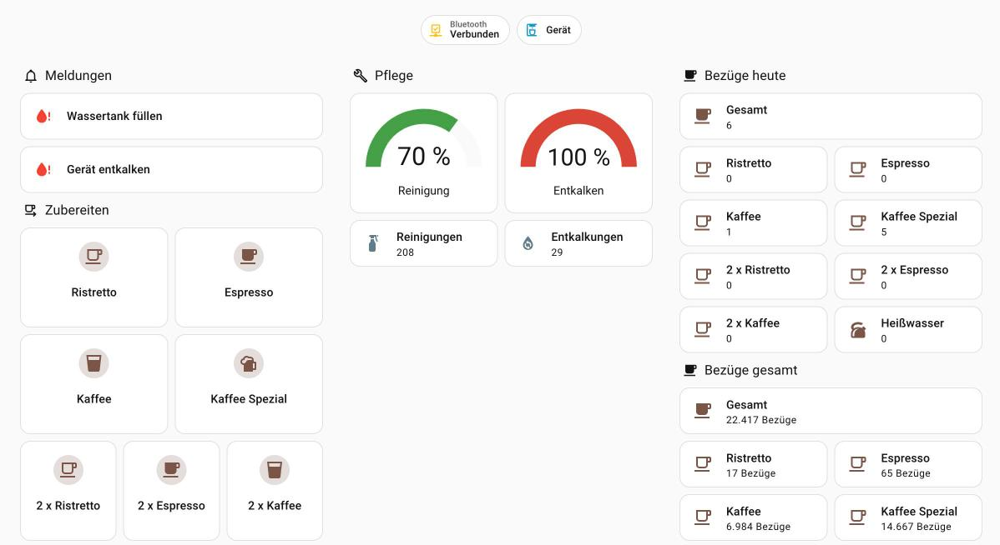
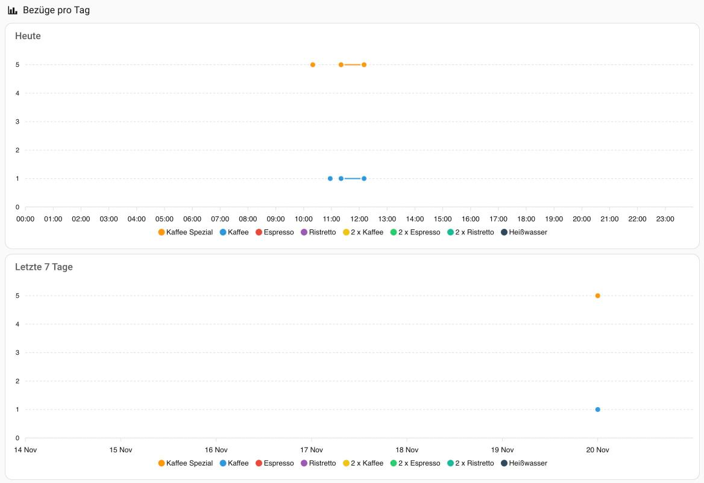

# Dashboard und Tageszähler

[English](dashboard.md) | **Deutsch** · [Zurück zur Übersicht](../README.de.md)





Ein fertiges Beispiel für eine WE6 liegt in [`examples/`](../examples/), auf Deutsch (`examples/de/`, wie in den Bildern) und Englisch (`examples/en/`). Den Ordner passend zur Sprache von Home Assistant wählen: Die Zubereiten-Kacheln verwenden die Produktnamen der Integration, und die richten sich nach der Sprache.

## Was enthalten ist

- **`package.yaml`:** Tageszähler (`sensor.jura_we6_*_heute`), ihre Helfer, das Skript `jura_we6_zubereiten` und die Automation, die den Nullpunkt des Tages setzt.
- **`dashboard.yaml`:**
  - Meldungen, Vorwarnungen („bald“) in Gelb
  - Zubereiten per Antippen mit Rückfrage und individuelles Zubereiten (Produkt, Stärke, Temperatur, Menge)
  - Pflege: Reinigen und dazu Entkalken oder Filter, je nachdem, was die Maschine benutzt
  - Bezüge heute und gesamt
  - Diagramme „Heute“ (jeder Messwert) und „Letzte 7 Tage“ (ein Wert pro Tag)

Das Dashboard braucht [apexcharts-card](https://github.com/RomRider/apexcharts-card).

## Einrichten

1. apexcharts-card installieren (HACS).
2. In beiden Dateien `jura_we6_xxxxxxxxxxxx` durch das eigene Entitäts-Präfix ersetzen (*Einstellungen › Entitäten*, Suche „jura“).
3. `package.yaml` nach `/config/packages/` legen. Packages müssen in der `configuration.yaml` eingeschaltet sein:
   ```yaml
   homeassistant:
     packages: !include_dir_named packages
   ```
   Konfiguration prüfen, dann Home Assistant neu starten.
4. Dashboard anlegen (*Einstellungen › Dashboards › Dashboard hinzufügen › Neu von Grund auf*), den Raw-Konfigurationseditor öffnen und `dashboard.yaml` einfügen.
5. Andere Modelle: nicht vorhandene Produkte entfernen und die Produktsensoren anpassen (`sensor.<präfix>_product_*`).

## So arbeiten die Tageszähler

Die Maschine liefert nur Gesamtzähler, die Integration liest sie jede Minute, solange die Maschine an ist. Den eigenen Tageszähler der Maschine kann man über Bluetooth nicht lesen (siehe [Analyse](analysis.de.md#ergebnisse-für-die-we6)).

- Beim ersten Verbinden des Tages drückt die Automation sofort *Statistik aktualisieren* und speichert die Gesamtzähler als Nullpunkt.
- „Heute“ ist der aktuelle Stand minus Nullpunkt.
- Es wird nichts interpoliert. Bezüge ohne Messung zählen in den Gesamtzählern, werden aber keinem Tag zugeordnet. Das passiert, wenn Home Assistant, der Bluetooth-Proxy oder Bluetooth aus sind oder die Maschine vor der nächsten Abfrage ausgeschaltet wird.
- Ohne Messung an einem Tag bleiben die Tageszähler bei 0.

## Pflege-Kacheln

Entkalken und Filter erscheinen nur, wenn die Maschine sie benutzt. Ohne Filter meldet die Maschine den Filter als „nicht benutzt“, die Filter-Kacheln verschwinden. Mit einem CLARIS-Pro-Smart-Filter fordert die WE6 laut Anleitung kein Entkalken mehr an; meldet sie Entkalken dann als „nicht benutzt“, verschwinden die Entkalken-Kacheln genauso. Mit Filter geprüft ist das noch nicht. Siehe [Entitäten](entities.de.md#ausgeblendet-solange-nicht-benutzt).
