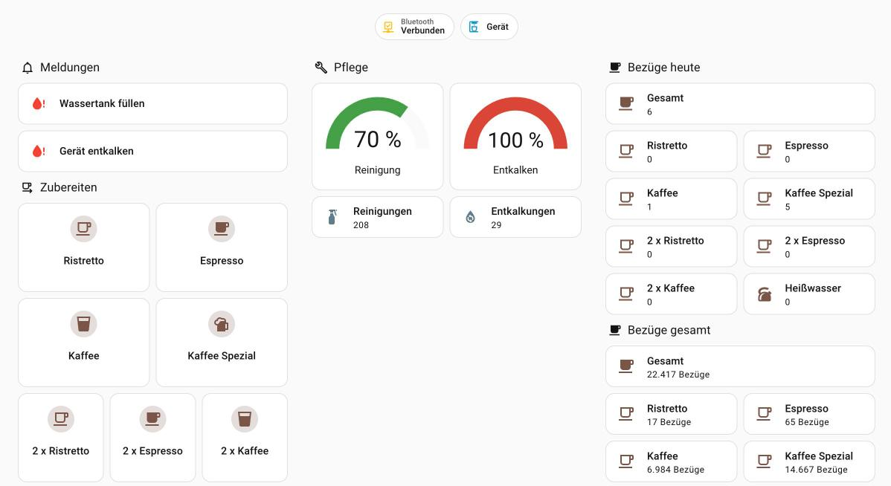
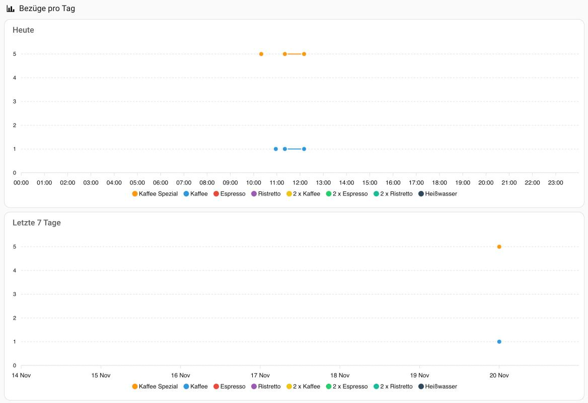

# Dashboard and daily counters

**English** | [Deutsch](dashboard.de.md) · [Back to the overview](../README.md)





A ready-made example for a WE6 is in [`examples/`](../examples/), in English (`examples/en/`) and German (`examples/de/`, as in the screenshots). Pick the folder that matches your Home Assistant language: the brew buttons use the product names of the integration, and those follow the language.

## What is included

- **`package.yaml`:** daily counters (`sensor.jura_we6_*_today`), their helpers, the script `jura_we6_brew` and the automation that sets the daily zero point.
- **`dashboard.yaml`:**
  - alerts, early warnings ("soon") in amber
  - one-tap brewing with confirmation, and custom brewing (product, strength, temperature, amount)
  - maintenance: cleaning plus descaling or filter, whichever the machine uses
  - products today and in total
  - charts "Today" (every reading) and "Last 7 days" (one value per day)

The dashboard needs [apexcharts-card](https://github.com/RomRider/apexcharts-card).

## Setup

1. Install apexcharts-card (HACS).
2. In both files, replace `jura_we6_xxxxxxxxxxxx` with your entity prefix (*Settings › Entities*, search for "jura").
3. Save `package.yaml` in `/config/packages/`. Packages must be enabled in `configuration.yaml`:
   ```yaml
   homeassistant:
     packages: !include_dir_named packages
   ```
   Check the configuration, then restart Home Assistant.
4. Create a dashboard (*Settings › Dashboards › Add dashboard › New dashboard from scratch*), open the raw configuration editor and paste `dashboard.yaml`.
5. Other models: remove the products your machine does not have and adapt the product sensors (`sensor.<prefix>_product_*`).

## How the daily counters work

The machine only reports totals, and the integration reads them every minute while the machine is on. The machine's own daily counter cannot be read over Bluetooth (see [Analysis](analysis.md#results-for-the-we6)).

- On the first connection of the day the automation presses *Refresh statistics* at once and stores the totals as the zero point.
- "Today" is the current total minus that zero point.
- Nothing is interpolated. Products made while no reading was possible are counted in the totals but not assigned to any day. That happens when Home Assistant, the Bluetooth proxy or Bluetooth is down, or when the machine is switched off before the next reading.
- Without a reading on a day the daily counters stay at 0.

## Maintenance tiles

Descaling and filter tiles are only shown when the machine uses them. Without a filter the machine reports the filter as "not used", and the filter tiles disappear. With a CLARIS Pro Smart filter the WE6 no longer asks for descaling (according to its manual); if it then reports descaling as "not used", the descaling tiles disappear the same way. That case has not been checked with a filter yet. See [Entities](entities.md#hidden-while-not-used).
